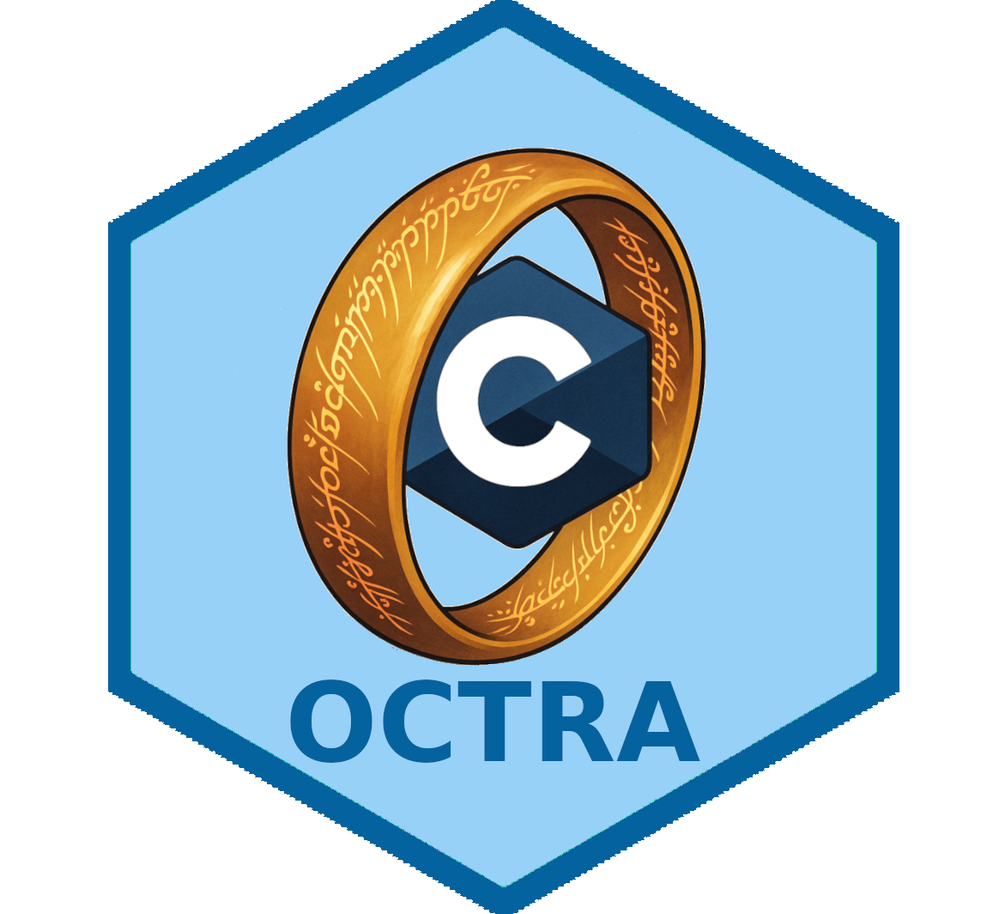

<p align="center">
    <h1>Datamunge</h1>
</p>

<p align="center">
  
</p>

> One C to rule them all, one C to find them, one C to bring them all and in the darkness...

---

Datamunge is a C/C++ project that has (nearly) automatically generated bindings for a
variety of languages, including Python, R, JavaScript, Lua, PHP, Java, C#, D
and Go. It is merely meant to be used as a kickstart template for similar
projects that need to provide bindings to multiple languages. As such, it is
permissively licensed under the Unlicense.

It uses CMake as the build system, and Just as a task runner. The project
maintains a nix flake for easy development and testing.

To demonstrate nontrivial examples, it provides simple implementations of some
common datastructures (e.g. dynamic array) written in C and bound to all
targeted binding languages. It is meant to be installable from any of the
supported languages' package managers (e.g. PyPI for Python, CRAN for R, npm
for JavaScript, etc). Thus, it also provides build configurations for these
package managers along with necessary packaging files for each language. While
this makes the project more complex, it also means that there is a single source
of truth for the core implementation, and that any bug fixes or improvements
can be made in one place and propagated to all bindings.

## 🚗 Test drive

### ❄️ NixOS

The easiest way to test drive the project is to use the provided Nix flake. You can
use the following command to enter a development shell with all dependencies:

```bash
nix develop
```

If Zsh completion mixes Homebrew and Nix versions of `just`, source
`scripts/just-completion.zsh` after `compinit` in your Zsh startup configuration.
It selects the active executable's completion protocol again whenever direnv
changes `PATH`. This prevents newer dynamic completion loaders from executing
an older `just`'s default recipe when you press Tab.

To build the project

```bash
just build
```

`just build` and `just build-cpp` build the core in Release mode. Standalone CMake builds
also default to Release when no build type is selected; use
`-DCMAKE_BUILD_TYPE=Debug` for an explicit debug build. The TensorFlow comparison
uses a separate Release build of both the core and benchmark driver; see
[the comparison workflow](benchmarks/TENSORFLOW.md).
All performance plans and TensorFlow/native comparison tables live in
[PERFORMANCE.md](PERFORMANCE.md).

to run tests:

```bash
just test
```

to build examples:

```bash
just examples
```

to run TARGET example:

```bash
just run TARGET=example_name
```

## Renaming this template

This repo is intended to be cloned and renamed. All occurrences of the project name are expected to be `datamunge` (lowercase) unless casing is required by a particular ecosystem.

- Rename everything (file contents + paths): `./rename_datamunge <new_project_name>`
  - `<new_project_name>` must be lowercase (a-z, 0-9, `_` or `-`)

## Bindings

See [the binding workflow and audit](docs/bindings.md) for source packages, regeneration, and the current language coverage.

### Test Drive

#### Python

```bash
just build-python
just test-python
just repl-python
```

#### R

```bash
just build-r
just test-r
just repl-r
```

#### Javascript

```bash
just build-javascript
just test-javascript
just repl-javascript
```

#### Lua

```bash
just run-lua
just repl-lua
just test-lua
```

#### Rust

```bash
just run-rust
just repl-rust
just test-rust
```

Binding support is (to be) provided for the following languages:

| Language   | Name        | Implemented |
| ---------- | ----------- | ----------- |
| C#         | DatamungeDotNet | ✅          |
| D          | DDatamunge      | ✅          |
| Go         | Godatamunge     | ✅          |
| Guile      | DatamungeGuile  | ✅          |
| Java       | Jdatamunge      | ✅          |
| Javascript | DatamungeJS     | ✅          |
| Lua        | Ldatamunge      | ✅          |
| OCaml      | DatamungeML     | ✅          |
| Octave     | MDatamunge      | ✅          |
| PHP        | DatamungePHP    | ✅          |
| Perl       | Pdatamunge      | ✅          |
| Python     | PyDatamunge     | ✅          |
| R          | DatamungeR      | ✅          |
| Ruby       | RbDatamunge     | ✅          |
| Rust       | RustDatamunge   | ✅          |
| Tcl/TK     | DatamungeTK     | ✅          |

Each binding lives under `src/` (e.g. `src/rustdatamunge/`, `src/godatamunge/`, `src/octruby/`),
with SWIG generator inputs kept alongside each binding (typically `src/<binding>/swig/`).
The tensor/NN facade is currently exposed in Python and R; the other bindings
cover their existing core APIs. The C/C++ core remains the single
source of truth; bindings are (re)generated via the `just prebuild-*` /
`just build-*` workflows.

CNN and autoencoder examples (sections 1 and 2) are available in
[C++](examples/cpp/nn/README.md) and through [Python/SWIG](examples/python/nn/README.md).

The NN language rewrite covers 414 canonical C++ examples across foundations,
CNNs, autoencoders, generative models, recurrent networks, attention and RL.
Actual implementations use the functional SWIG API (`pydatamunge.nn` /
`datamungerNN::nn`) with models and loops written in each language. Track completed
ports and validation in [the migration ledger](examples/nn/language_status.json)
with `just nn-language-status`; compiled reference wrappers do not count as ports.

Run a completed port with `just python-example NAME epochs=5` or
`just r-example NAME epochs=5`. Both commands reject unported examples; use
`just run-nn NAME` for the canonical C++ reference. Classification ports print a
confusion matrix. See [migration notes](docs/nn-language-migration.md) and the
[Python](examples/python/nn/README.md) / [R](examples/r/nn/README.md) example docs.
